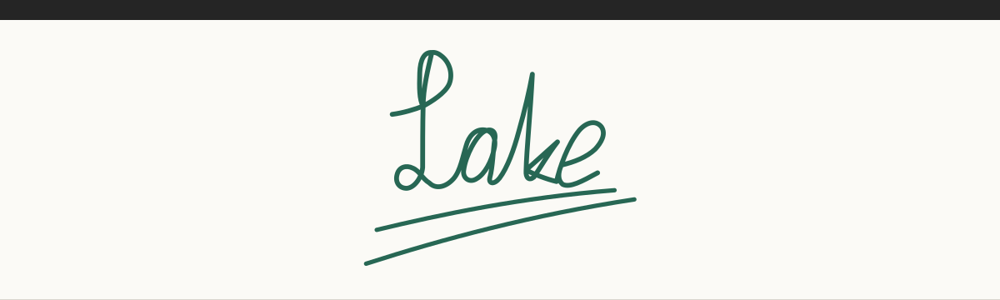
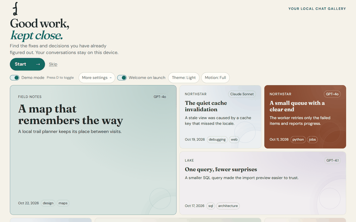
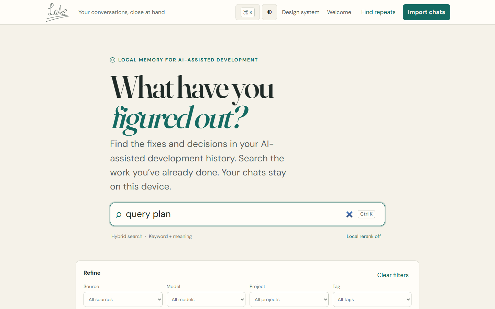
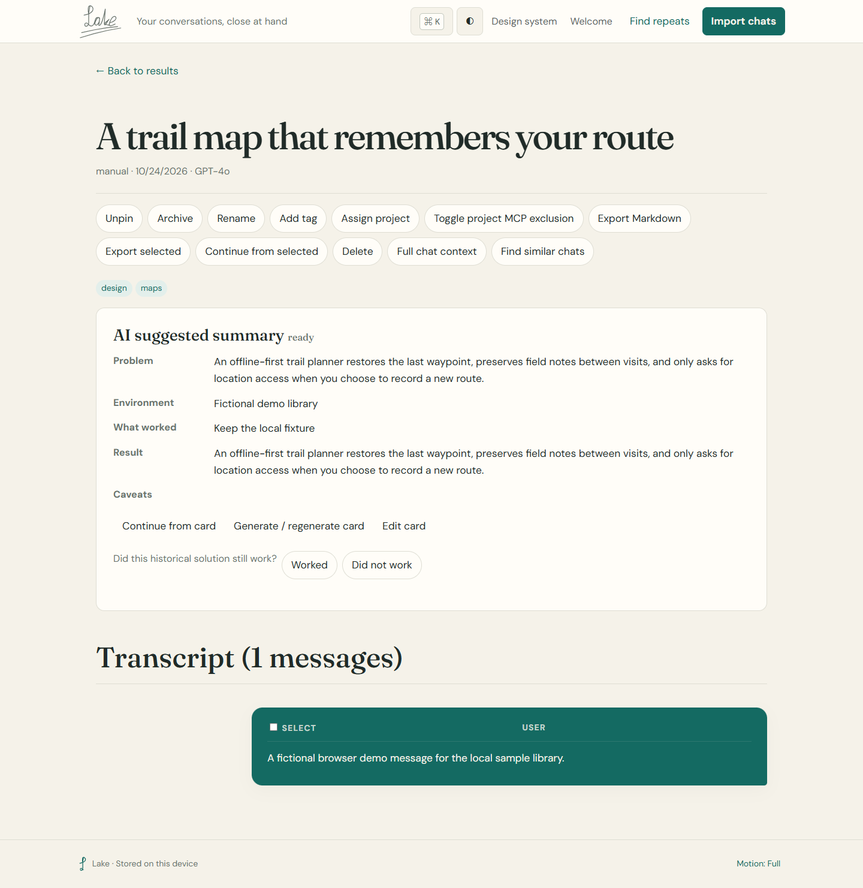
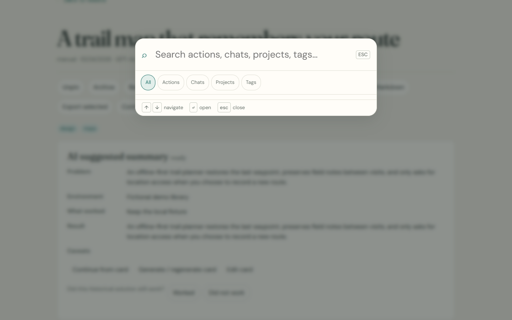
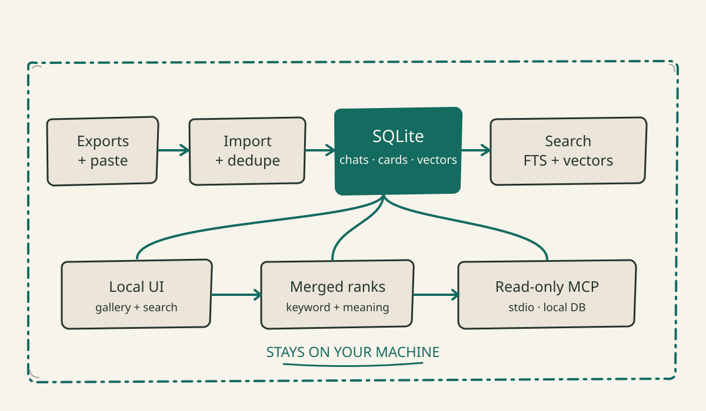

<picture>
  <source media="(prefers-color-scheme: dark)" srcset="lake/static/brand/readme-header-dark.svg">
  
</picture>

# Lake

Private, local-first gallery for your AI chats: searchable, visual, and ready to **continue from here**.

[](LICENSE)
[](https://www.python.org/)
[](https://github.com/temanhattan/Lake/actions/workflows/ci.yml)

<p align="center">
  
</p>

<picture>
  <source media="(prefers-color-scheme: dark)" srcset="docs/assets/readme/welcome-dark.png">
  
</picture>
<picture>
  <source media="(prefers-color-scheme: dark)" srcset="docs/assets/readme/search-dark.png">
  
</picture>
<picture>
  <source media="(prefers-color-scheme: dark)" srcset="docs/assets/readme/chat-dark.png">
  
</picture>
<picture>
  <source media="(prefers-color-scheme: dark)" srcset="docs/assets/readme/palette-dark.png">
  
</picture>

## What you get

- Import ChatGPT, Claude, Markdown, text, or pasted transcripts.
- Browse a calm, visual wall of conversations.
- Search by keyword, meaning, or both.
- Keep everything in a local SQLite database.
- Turn a long chat into a compact context block.
- Continue in any AI tool without losing the thread.
- Connect coding agents through a read-only local MCP server.

## How it works

<picture>
  <source media="(prefers-color-scheme: dark)" srcset="docs/diagrams/architecture-dark.svg">
  
</picture>

Search fuses SQLite FTS5 keyword matches with local vector results. Cards and context blocks are generated only when you ask, through your local Ollama endpoint. The diagram and PNG fallbacks are reproducibly built from [docs/diagrams/src/](docs/diagrams/src/).

## Privacy

- Everything stays on your machine, including chats, cards, indexes, and jobs.
- Lake has no telemetry or hosted API.
- Read-only MCP uses local stdio and redacts detected secrets by default.

See [docs/privacy.md](docs/privacy.md) for boundaries and redaction details.

## Quick start

```powershell
pipx install "git+https://github.com/temanhattan/Lake.git"
New-Item -ItemType Directory imports -Force
lake import .\imports
lake serve
```

Open <http://127.0.0.1:8765>, then import an export from **Import**. For Ollama setup and configuration options, see [docs/ollama.md](docs/ollama.md).

For a source checkout, install the pinned development environment with
`python -m pip install -r requirements-dev.txt`. Lake stores data under the
per-user OS data directory by default; set `LAKE_DATA_DIR` or `data_dir` in
`config.toml` to choose another location.

## Models

| Model | Role | License |
|---|---|---|
| `qwen2.5:3b` | Local cards and context | Qwen license |
| `nomic-embed-text` | Local embeddings | Apache-2.0 |
| `bge-m3` | Optional multilingual embeddings | MIT |

Model weights are not distributed by Lake; download them through Ollama.

## Roadmap

- [x] Local import, dedupe, cards, and hybrid search
- [x] Welcome wall and continue-from-here blocks
- [x] Read-only MCP over stdio
- [ ] More export parsers
- [ ] Better local model setup guidance

## Build the visuals

```powershell
python docs/diagrams/build.py
```

The diagrams use hand-drawn SVG templates, embed the locally vendored OFL font, and render 2× PNG fallbacks in Chrome. README screenshots and the demo-only walkthrough are captured with the fictional browser harness described in [docs/testing.md](docs/testing.md).

## Docs

[Architecture](docs/architecture.md) · [Imports](docs/imports.md) · [Ollama](docs/ollama.md) · [MCP](docs/mcp.md) · [Privacy](docs/privacy.md) · [Testing](docs/testing.md)

## License

Lake's source code and associated documentation are available under the [Apache License 2.0](LICENSE).

**Brand note:** the Lake name, wordmark, and visual identity are reserved; see [LICENSE-BRAND.md](LICENSE-BRAND.md).
